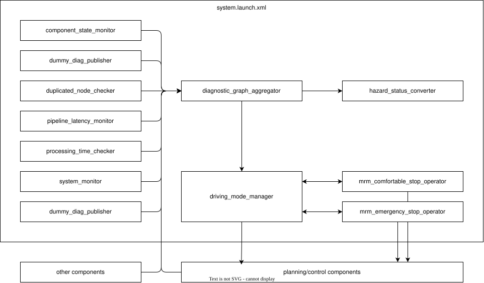

# autoware_system_launch

## Public Launch Files

This package provides the following launch files. Please do not use any files not listed here, as they are subject to change due to implementation requirements.

| File                     | Description              |
| ------------------------ | ------------------------ |
| launch/system.launch.xml | Launch system component. |

## Launch Arguments

The launch/system.launch.xml has the following arguments:

| Name                                   | Type | Required | Description                                                 |
| -------------------------------------- | ---- | -------- | ----------------------------------------------------------- |
| use_sim_time                           | bool | no       | Use simulation time.                                        |
| config_directory                       | path | no       | The configuration directory, which will be described later. |
| planning_setting                       | enum | no       | Planning component: rule_based or diffusion_planner.        |
| run_mode                               | enum | no       | Run mode: online, logging_simulation, planning_simulation.  |
| sensor_model                           | str  | yes      | Sensor model.                                               |
| launch_system_monitor                  | bool | no       | Launch system_monitor.                                      |
| launch_dummy_diag_publisher            | bool | yes      | Launch dummy_diag_publisher for simulation.                 |
| launch_fault_injection                 | bool | no       | Launch fault_injection to test diagnostics.                 |
| launch_rqt_reconfigure                 | bool | no       | Launch rqt reconfigure.                                     |
| launch_rqt_runtime_monitor             | bool | no       | Launch rqt runtime monitor to see /diagnostics.             |
| launch_rqt_runtime_monitor_err         | bool | no       | Launch rqt robot monitor to see /diagnostics_err.           |
| launch_rqt_robot_monitor               | bool | no       | Launch rqt robot monitor to see /diagnostics_agg.           |
| diagnostic_graph_aggregator_graph_vars | str  | no       | Parameter for diagnostic_graph_aggregator.                  |
| availability_converter_param_path      | path | no       | Parameter for diagnostic_graph_aggregator.                  |
| driving_mode_manager_param_path        | path | no       | Parameter for driving_mode_manager.                         |
| fault_injection_output_diagnostics     | str  | no       | Remapping for fault_injection.                              |
| diag_struct_topic                      | str  | no       | Remapping for diagnostic_graph_aggregator.                  |
| diag_status_topic                      | str  | no       | Remapping for diagnostic_graph_aggregator.                  |
| diag_reset_srv                         | str  | no       | Remapping for diagnostic_graph_aggregator.                  |
| mrm_state_topic                        | str  | no       | Remapping for diagnostic_graph_aggregator.                  |
| change_operation_mode_srv              | str  | no       | Remapping for diagnostic_graph_aggregator.                  |
| change_autoware_control_srv            | str  | no       | Remapping for diagnostic_graph_aggregator.                  |

## Config Directory

For the config_directory argument, specify the directory containing the parameter file, organized according to the following structure.
For details regarding each parameter file, please refer to the documentation for the relevant package.

| Path                                                                   | Package                                |
| ---------------------------------------------------------------------- | -------------------------------------- |
| command_mode/converter.param.yaml                                      | autoware_diagnostic_graph_aggregator   |
| component_state_monitor/topics.yaml                                    | autoware_component_state_monitor       |
| diagnostics/autoware-main-e2e.yaml                                     | autoware_diagnostic_graph_aggregator   |
| diagnostics/autoware-main.yaml                                         | autoware_diagnostic_graph_aggregator   |
| diagnostics/dummy_diag_publisher.param.yaml                            | autoware_dummy_diag_publisher          |
| duplicated_node_checker/duplicated_node_checker.param.yaml             | autoware_duplicated_node_checker       |
| mrm_comfortable_stop_operator/mrm_comfortable_stop_operator.param.yaml | autoware_mrm_comfortable_stop_operator |
| mrm_emergency_stop_operator/mrm_emergency_stop_operator.param.yaml     | autoware_mrm_emergency_stop_operator   |
| mrm_handler/mrm_handler.param.yaml                                     | autoware_mrm_handler                   |
| pipeline_latency_monitor/pipeline_latency_monitor.param.yaml           | autoware_pipeline_latency_monitor      |
| processing_time_checker/processing_time_checker.param.yaml             | autoware_processing_time_checker       |
| system_monitor/cpu_monitor.param.yaml                                  | autoware_system_monitor                |
| system_monitor/gpu_monitor.param.yaml                                  | autoware_system_monitor                |
| system_monitor/hdd_monitor.param.yaml                                  | autoware_system_monitor                |
| system_monitor/mem_monitor.param.yaml                                  | autoware_system_monitor                |
| system_monitor/net_monitor.param.yaml                                  | autoware_system_monitor                |
| system_monitor/ntp_monitor.param.yaml                                  | autoware_system_monitor                |
| system_monitor/process_monitor.param.yaml                              | autoware_system_monitor                |
| system_monitor/voltage_monitor.param.yaml                              | autoware_system_monitor                |

## Structure



## Package Dependencies

Please see `<exec_depend>` in `package.xml`.

## Usage

Note that you should provide parameter paths as `PACKAGE_param_path`. The list of parameter paths you should provide is written at the top of `system.launch.xml`.

```xml
  <include file="$(find-pkg-share autoware_system_launch)/launch/system.launch.xml">
    <arg name="run_mode" value="online"/>
    <arg name="sensor_model" value="SENSOR_MODEL"/>

    <!-- Parameter files -->
    <arg name="FOO_param_path" value="..."/>
    <arg name="BAR_param_path" value="..."/>
    ...
  </include>
```
